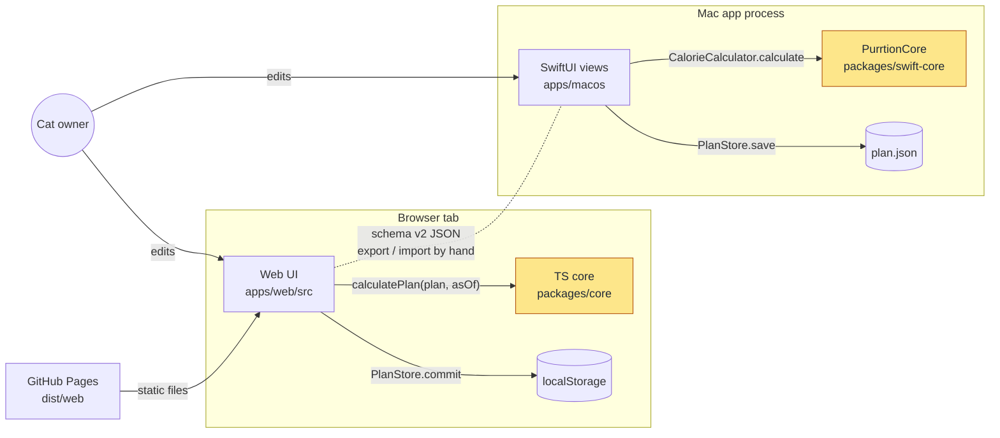
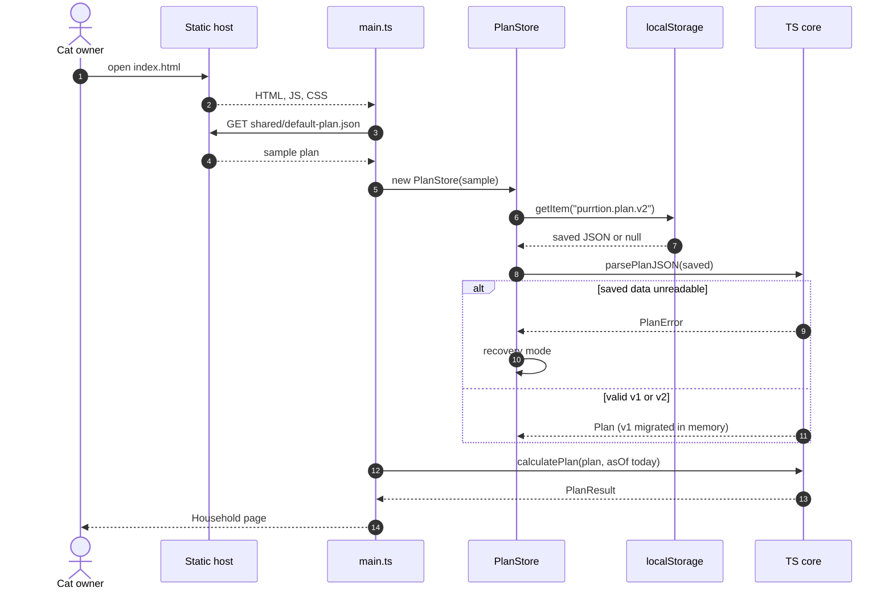
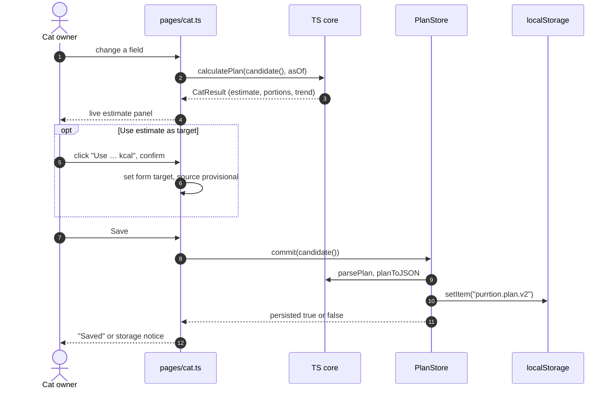
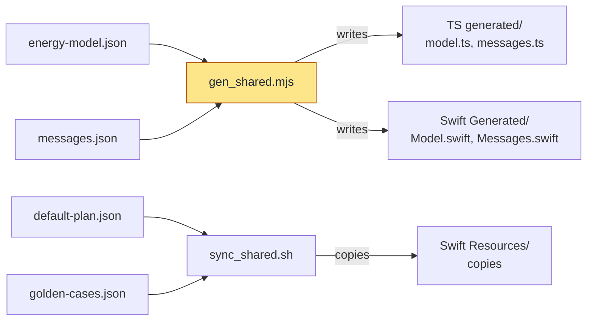
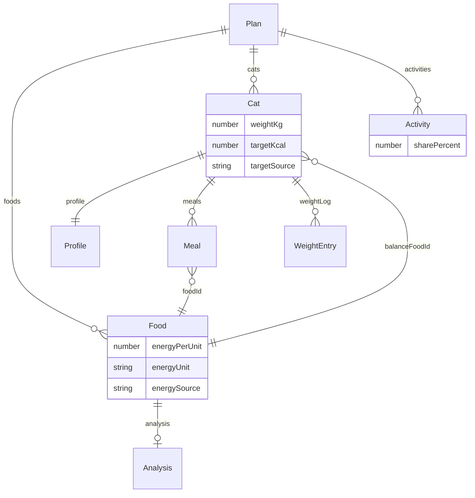
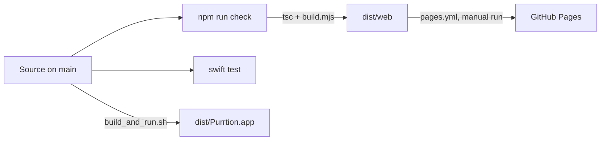

# Architecture

Purrtion is one product built twice: a static website (TypeScript, no framework) and a native
Mac app (SwiftUI). Each has its own engine that validates a plan and calculates estimates and
portions, and both engines read the same generated constants and pass the same golden cases.
There is no server, account or sync: the website keeps the plan in `localStorage`, the Mac app
in a JSON file, and the two meet only when the user exports a plan from one and imports it in
the other. Start with the overview below, then the two user journeys, then the
[code map](#code-map).

## Two engines, one contract

What runs where, and what does each part talk to?

Purrtion has no server. The browser UI imports the pure TypeScript core (`packages/core`);
the Mac UI imports the pure Foundation `PurrtionCore` Swift library (`packages/swift-core`).
SwiftUI renders real Mac controls. The Mac app contains no WebView, JavaScript runtime or
website bundle. GitHub Pages (or any static host) only serves files; the Content Security
Policy limits the website to requests to its own origin. The dotted link is a file the user
moves; nothing synchronises automatically.

A shared Rust/Wasm/FFI kernel would remove duplicated arithmetic but adds build tooling and an
interop boundary. A WebView would share UI but not give a native SwiftUI experience. Two
readable engines, one interchange contract, one source of constants and messages, and identical
golden cases are the chosen trade-off.

The engine specification is [ENGINE.md](ENGINE.md) (estimator, food analysis, trend, nutrient
checks), the allocation arithmetic is [CALCULATIONS.md](CALCULATIONS.md), and the evidence is
[SCIENCE.md](SCIENCE.md).

Where in the code:
- [apps/web/src/main.ts](../apps/web/src/main.ts): website boot, navigation, import/export.
- [packages/core/src/calculation.ts](../packages/core/src/calculation.ts): `calculatePlan`.
- [apps/macos/Sources/App/PurrtionApp.swift](../apps/macos/Sources/App/PurrtionApp.swift): Mac scenes.
- [packages/swift-core/Sources/PurrtionCore/CalorieCalculator.swift](../packages/swift-core/Sources/PurrtionCore/CalorieCalculator.swift): `CalorieCalculator.calculate`.

## What happens when you use it

### Opening the website

How does the website get from an empty page to the household view?

The sample plan (steps 3–4) is always loaded: it is what an empty browser shows and what
"Reset to the sample plan" restores. Step 6 falls back to `purrtion.plan.v1` when the v2 key is
absent. In recovery mode (step 10) the app shows the sample and refuses to save over the damaged
text until the user imports or resets, which first copies it to `purrtion.plan.v2.recovery`.
Step 12 happens in `household()`; every page recalculates the whole plan on each render, with today's
local date passed in so the core stays deterministic.

Where in the code:
- [apps/web/src/main.ts](../apps/web/src/main.ts): `boot()`, `render()`.
- [apps/web/src/store.ts](../apps/web/src/store.ts): `PlanStore.reload()`.
- [packages/core/src/validation.ts](../packages/core/src/validation.ts): `parsePlanJSON`, `migrateV1`.
- [apps/web/src/pages/household.ts](../apps/web/src/pages/household.ts): household page.

### Editing a cat and saving

What happens between typing in the cat form and the plan being saved, and where does the
"never change the target by itself" rule live?

Every keystroke (step 1) builds a candidate plan from the form and recalculates it, but nothing is
stored. If the candidate is invalid, the panel is cleared and marked stale instead of showing an
old result. "Use estimate" (steps 5–6) only writes into the form, after a confirmation, and only
when the estimate status is `ok`; `calculatePlan` itself never writes `targetKcal`. Save (step 7)
is the only path into storage; `commit` validates again, and returns `false` in recovery mode or
when the write fails, so the UI never claims a save that did not happen. The Mac app follows the
same shape: `CatEditorView` calls `PlanStore.calculate` while editing and `PlanStore.save` on
Save, which validates with `PlanValidator` and writes `plan.json` atomically.

Where in the code:
- [apps/web/src/pages/cat.ts](../apps/web/src/pages/cat.ts): `update()`, `useEstimate()`, the form's submit handler.
- [apps/web/src/store.ts](../apps/web/src/store.ts): `PlanStore.commit()`.
- [apps/macos/Sources/Views/CatEditorView.swift](../apps/macos/Sources/Views/CatEditorView.swift) and
  [apps/macos/Sources/Stores/PlanStore.swift](../apps/macos/Sources/Stores/PlanStore.swift): the Mac equivalent.

## Single source of constants and messages

How do the two engines end up with identical numbers and texts?

All four inputs live in `shared/`. Generated and copied files are checked in, so neither
toolchain needs the other to build; `npm run check` fails if any of them has drifted.

- `shared/energy-model.json` holds every coefficient, threshold and table.
- `shared/messages.json` holds the English and German text of every warning, refer reason,
  missing-input prompt, note and suggestion reason. Both locales must have exactly the same keys.
- `script/gen_shared.mjs` generates `packages/core/src/generated/{model,messages}.ts` and
  `packages/swift-core/Sources/PurrtionCore/Generated/{Model,Messages}.swift`. Generated files
  carry a "do not edit" header. `npm run gen:shared` writes them; `node script/gen_shared.mjs --check`
  fails on drift and runs as part of `npm run check` (and therefore in CI and in the Pages build).
- `shared/default-plan.json` (the example household) and `shared/golden-cases.json` (117 cases)
  are also shared inputs. SwiftPM needs resources inside the target directory, so they have
  checked-in copies; `script/sync_shared.sh` (`--check` to detect drift) maintains them. The
  script `build_and_run.sh` copies native resources into the staged `.app`.

Engine code must not repeat literal coefficients; it reads the generated model.

## Module boundaries

The core contains value models, validation, pure calculations (allocation, estimator, food
analysis, trend, nutrient checks) and text serialisation (JSON, CSV). It has no DOM, SwiftUI,
filesystem writes, networking, timers or application state. `calculatePlan(plan, { asOf })`
takes the date as an argument, so results are deterministic; the UI passes today's local date.
Both cores validate at their public boundary.

The UI layer holds transient form state and submits complete candidate plans. Invalid entries do
not change saved data. The browser builds DOM with text nodes, never by interpolating user values
into HTML. New cats go through a guided setup (`apps/web/src/wizard.ts`, with the mascot
"Professor Purr" in `mascot.ts`; `AddCatWizard.swift` on the Mac) and nothing is saved until the
last step.

Persistence is in `apps/web/src/store.ts` and `apps/macos/Sources/Stores/PlanStore.swift`. On
failure the UI says that the view is a sample or in-memory state rather than claiming a save.
Unreadable saved data is never silently overwritten. Exports are plain UTF-8 files; there is no
hidden sync.

The native app has one shared `@Observable` store and scene-local selection, a `WindowGroup`
root scene and a real `Settings` scene. Editors own drafts and require Save before navigation.
The website asks before discarding dirty forms.

## Schema v2 and migration from v1

The root object has `schemaVersion`, `name`, `foods`, `cats` and `activities`. IDs are stable
strings and units are explicit strings; a unit is never inferred from the size of a number.

What is in a plan, and how do its parts refer to each other?

A cat's fixed `meals` are eaten first; its balance food fills whatever is left of `targetKcal`,
and that balance is split across the plan-wide `activities` (shares sum to 100 %). Results
(`PlanResult`) are never stored: they are recalculated from the plan on every render. The same
shape is `Plan` in [packages/core/src/models.ts](../packages/core/src/models.ts) and
[packages/swift-core/Sources/PurrtionCore/Models.swift](../packages/swift-core/Sources/PurrtionCore/Models.swift),
and the interchange schema is [shared/plan.schema.json](../shared/plan.schema.json).

Version 2 (full field list in ENGINE.md §1):
- Foods gain `energySource: analysis` with an `analysis` object, and `lifeStageClaim`.
- Meals may reference any food; `dryFoodId` becomes `balanceFoodId`.
- Cats gain `icon`, a `profile` (age, sex, neuter status, BCS, lifestyle, health flags,
  reproduction, ideal weight and source, verified intake) and a `weightLog`.

Decoders accept v1 and v2. A v1 document is validated with the v1 rules (dry food must be dry,
meals wet) and then migrated: all-null profile, empty weight log, no analysis, life-stage claim
`unknown`. Export is always v2 and drops unknown fields. Any other `schemaVersion` is rejected.
A future schema needs an explicit migration and new golden cases, not field guessing.
`energySource: label` means the owner chose a label value; the app does not verify it.

## Storage

| Where | Key or path | Notes |
| --- | --- | --- |
| Browser plan | `localStorage` `purrtion.plan.v2` | If absent, `purrtion.plan.v1` is read and migrated in memory. The v1 key is never deleted. |
| Browser recovery | `purrtion.plan.v2.recovery` | Unreadable saved data, written only when the user explicitly replaces it (import or reset); the Method page exports it. |
| Browser previous plan | `purrtion.plan.v2.previous` | The readable plan that the last import or reset replaced; the Method page exports it. Never overwrites `.recovery`. |
| Browser language | `purrtion.locale` | `en` or `de`; otherwise the browser language, German if it starts with "de". |
| Mac plan | `~/Library/Application Support/Purrtion/plan.json` | Before the first v2 write over a v1 file it is copied to `plan-v1-backup.json`. Explicitly replacing a saved plan keeps a timestamped backup. |

A `storage` event from another tab reloads the plan when there are no unsaved edits. With
unsaved edits the in-memory plan is kept and a conflict notice is shown; saving then overwrites
the other tab's change (no merge). Unreadable data written elsewhere enters recovery mode.

## Internationalisation

Languages are English and German. Engine texts come from `shared/messages.json` through the
generated tables (`messages`, and `Messages.message` on the Mac). UI strings live in
`apps/web/src/i18n.ts` (typed key set; the German table must have the same keys) and in
`apps/macos/Sources/Support/L10nStrings.swift` (`L10n.swift`). Numbers are formatted per locale.
Not yet localised: validation error messages and CSV column headers (see the roadmap).

## Mathematics display

The estimate explanations and the Method page show formulas as MathML. The web app calls the vendored Temml (`temml.min.js`,
loaded with a same-origin script tag) from `apps/web/src/math.ts`. Only LaTeX built by the app is
rendered, with numbers formatted by `texNumber()`; user text is never put into LaTeX. If Temml
is missing or fails, the LaTeX source is shown in a `<code>` element. The vendored files, their
versions and licences are listed in `apps/web/vendor/README.md`.

## Fonts and brand assets

Headings, numerals and the wordmark use M PLUS Rounded 1c (Latin subset, weights 500 and 800),
self-hosted from `apps/web/fonts/` (OFL text included); no font is requested from a third party.
`brand/` holds the logo mark, favicon, app icon tile and its PNG exports, the macOS `.icns`,
and the sprite of 12 cat icons that is the single source for the web and the Mac drawing.
Usage rules are in `brand/README.md`. `script/build.mjs` copies the needed files into `dist/web`.

## Content Security Policy

`apps/web/index.html` carries a CSP meta tag: `default-src 'self'` with `script-src`, `style-src`
and `font-src` restricted to `'self'`, `img-src 'self' data:`, `connect-src 'self'`,
`object-src 'none'`, `base-uri 'self'` and `form-action 'none'`. The development server
(`script/serve.mjs`) sends an equivalent HTTP header that also adds `frame-ancestors 'none'`,
`X-Content-Type-Options: nosniff` and `Referrer-Policy: no-referrer`. `frame-ancestors` is not
honoured in a meta tag, and GitHub Pages does not let a site set response headers, so the
deployed site relies on the meta tag.

## Build and deployment

`script/build.mjs` runs the TypeScript compiler into `dist/web` and copies static inputs (HTML,
CSS, fonts, brand files, vendored Temml, shared JSON), then writes `.nojekyll`. All URLs are
relative, so the site works under a path prefix. `npm run dev` builds, watches and serves;
`npm run preview` serves the existing build on loopback.

How does source become a website and a Mac app?

`npm run check` is drift checks, `tsc --noEmit`, the build and the Node tests, in that order; a
failure stops the deploy. The Mac app is built locally only: `build_and_run.sh` stages the
`.app` and signs it ad hoc (`codesign --sign -`). There is no Developer ID signing,
notarisation or release upload in this repository.

CI (`.github/workflows/ci.yml`) runs only on a manual run or on a pull request opened by
Dependabot. The `web` job runs `npm ci`, `npm run check`, the source-archive test and the
Playwright smoke test in Chromium, WebKit and Firefox; the `macos` job runs the shared-file
check, `swift test` and `build_and_run.sh --build-only`. GitHub Pages
(`.github/workflows/pages.yml`) deploys only when someone runs the workflow by hand on `main`
(a push does not deploy): it runs `npm run check` and publishes `dist/web` with the official
Pages actions (repository setting: Pages source "GitHub Actions").

## Extension points

The clinical estimator exists as an opt-in, separately labelled estimate; it distinguishes an
estimate from an owner- or veterinarian-selected target and never writes `targetKcal`. Calculation
helpers must not diagnose body condition: BCS and muscle condition are owner or veterinarian inputs.
The weight log is a separate domain model beside the plan; meal logging should be separate as well.
Synchronisation requires conflict handling, consent, identity, privacy design and account
deletion, not a few background fetch calls.

Before changing formulas, constants or validation, update the shared JSON and add cross-language
golden cases. Before adding UI infrastructure, check whether an existing page or native view can
handle the feature without a framework or service.

## Code map

In the order a newcomer would read it:

| Path | Responsibility |
| --- | --- |
| [shared/](../shared/) | The contract: energy model, messages, sample plan, schema, golden cases. |
| [packages/core/src/models.ts](../packages/core/src/models.ts) | TypeScript types of the plan and of results. |
| [packages/core/src/validation.ts](../packages/core/src/validation.ts) | `parsePlan`, v1 → v2 migration, import size limit. |
| [packages/core/src/calculation.ts](../packages/core/src/calculation.ts) | `calculatePlan`: balance food, rounding, activity split, warnings. |
| [packages/core/src/estimator.ts](../packages/core/src/estimator.ts) | Energy estimate (RER, MER, stages, refer reasons). |
| [packages/core/src/trend.ts](../packages/core/src/trend.ts), [nutrition.ts](../packages/core/src/nutrition.ts), [food-analysis.ts](../packages/core/src/food-analysis.ts) | Weight trend, nutrient checks, label analysis. |
| [packages/core/src/export.ts](../packages/core/src/export.ts) | JSON and CSV export. |
| [apps/web/src/main.ts](../apps/web/src/main.ts) | Website boot, navigation, import/export, cross-tab sync. |
| [apps/web/src/store.ts](../apps/web/src/store.ts) | `PlanStore`: `localStorage`, recovery and backup keys. |
| [apps/web/src/pages/](../apps/web/src/pages/) | Household, cat, foods and method pages. |
| [apps/web/src/wizard.ts](../apps/web/src/wizard.ts) | Guided setup with Professor Purr. |
| [apps/web/src/i18n.ts](../apps/web/src/i18n.ts) | English and German UI strings. |
| [packages/swift-core/Sources/PurrtionCore/](../packages/swift-core/Sources/PurrtionCore/) | Swift engine; same responsibilities as `packages/core`. |
| [apps/macos/Sources/](../apps/macos/Sources/) | SwiftUI app: `App/`, `Stores/PlanStore.swift`, `Views/`, `Support/`. |
| [script/](../script/) | Build, dev server, code generation, Mac build, source ZIP. |
| [packages/core/test/](../packages/core/test/), [apps/web/test/](../apps/web/test/), [packages/swift-core/Tests/](../packages/swift-core/Tests/), [tests/](../tests/) | Node tests, Swift tests, browser smoke test. |
